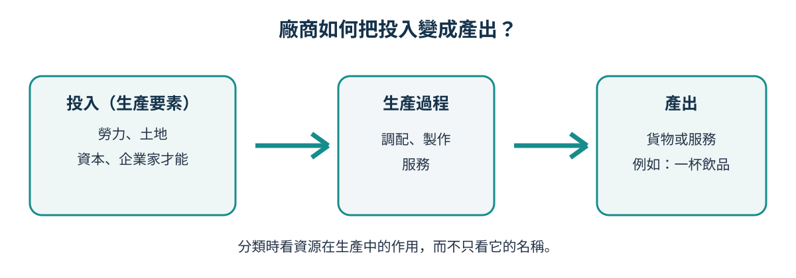
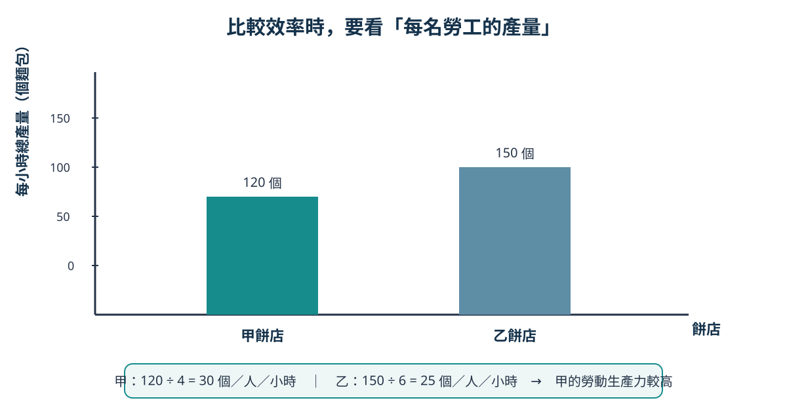

# Topic 4 生產要素和生產級別：生產、分工與生產要素

> 中四經濟｜主修 B 第 1 課｜日期：2026-10-16

## 今天要學會!

- 說出四種生產要素，並按它們在生產中的**作用**分類。
- 分辨「產量」和「勞動生產力」，並根據資料計算及比較勞動生產力。
- 解釋分工／專門化如何提高產量或生產力，以及它可能帶來的限制。
- 以「原因 → 生產過程 → 結果」的結構，解釋一個生產力改變的個案。

## 1. 廠商如何把投入變成產出？

廠商是把資源組合起來、生產貨物或服務的單位。例如一間香港茶飲店要製作一杯飲品，不只需要茶葉；它還需要店員、店舖、製冰機，以及決定售價和安排工作的經營者。



**投入**是用於生產的資源；**產出**是生產出來的貨物或服務。題目問「哪一種生產要素」時，不要只看物件的名稱；要看它在該生產過程中發揮甚麼作用。

### 四種生產要素

| 生產要素 | 意思 | 茶飲店例子 | 可得的報酬（答題常用） |
|---|---|---|---|
| 土地 | 自然資源，包括土地本身及天然資源 | 店舖用地、用水 | 租金 |
| 勞力 | 人的體力和腦力勞動 | 沖調飲品的店員、會計 | 工資 |
| 資本 | 用來協助生產的**人造生產物品** | 製冰機、封口機、收銀系統 | 利息 |
| 企業家才能 | 組織其他要素、作決策和承擔風險的能力 | 店主決定菜單、聘人、投資新機器 | 利潤 |

> **資本不等於金錢。** 現金本身未直接協助生產；用現金買入並投入生產的封口機，才是資本。  
> **土地不只是農地。** 只要是自然資源，例如海港、礦產、陽光和店舖所在地，也可屬土地。

### 分類小技巧：先問兩條問題

1. 它是大自然提供的資源嗎？是的話通常是**土地**。
2. 它是人製造、用來協助再生產其他貨物或服務的物品嗎？是的話通常是**資本**。  
   若不是，再看它是人的勞動（勞力），還是組織、決策及承擔風險的能力（企業家才能）。

## 2. 產量多，不一定代表生產力高

**產量**是某段時間內生產的總數量。  
**勞動生產力**是平均每單位勞力在某段時間內的產量：

```text
勞動生產力 = 總產量 ÷ 勞工數目
```

假如一間餅店今天多聘了兩名店員，總產量由 80 個麵包升至 100 個。這不自動表示每位店員做得更有效率；要把產量除以勞工數目才可比較。

### 逐步示範：兩間同類型餅店

| 餅店 | 每小時總產量（個麵包） | 勞工數目（人） | 每名勞工每小時產量 |
|---|---:|---:|---:|
| 甲 | 120 | 4 | ______ |
| 乙 | 150 | 6 | ______ |

**步驟 1：** 找出題目比較的是「每名勞工」的產出，所以用勞動生產力。  
**步驟 2：** 各自用「總產量 ÷ 勞工數目」計算。  
**步驟 3：** 再比較兩個結果，不要只比較 120 和 150。  



圖 2 顯示：乙的**總產量**較高（150 個），但甲每名勞工每小時做 30 個，乙每名勞工每小時做 25 個，所以甲的**勞動生產力**較高。讀圖時要先問：「縱軸量度的是總產量，還是每名勞工的產量？」

一間廠商的生產力可因以下因素改變：

```text
更合適的機器／培訓／工作流程
              ↓
每位勞工在同一時間可完成較多工作
              ↓
勞動生產力上升
```

反過來，機器故障、員工未熟習新系統、工序配合不佳，也可能令每位勞工的產出下降。

## 3. 分工和專門化：為甚麼「各自做好一部分」可能更快？

**分工**是把一項生產工作分成多個工序，由不同工人各自專責其中一項。  
**專門化**是個人、廠商或地區集中生產自己較有優勢的貨物、服務或某一道工序。

以網店處理訂單為例：

```text
沒有分工：甲、乙各自「找貨 → 包裝 → 列印運單 → 回覆客人」

有分工：  甲：找貨及包裝  ──→  乙：列印運單及安排寄件  ──→  顧客收貨
```

分工可能提高生產力，因為工人重複做同一工序，熟練程度會提高；他們也少了由一項工作轉換到另一項工作的時間。廠商於是可較容易採用專門機器或建立標準化流程。

| 分工可能帶來的好處 | 為甚麼會出現？ |
|---|---|
| 熟能生巧 | 重複同一工序，技能及速度提高。 |
| 減少轉換時間 | 不用反覆由包裝轉到收銀或客戶服務。 |
| 較易使用專門機器 | 為某一道工序購買合適工具可能更值得。 |

但分工**不是必定有利**。當市場很小、工序之間協調困難，或工作過度重複令員工感到厭倦時，分工的好處可能較小，甚至令效率下降。


## 必記定義

| 詞語 | HKDSE 答題用語 |
|---|---|
| 生產要素 | 用於生產貨物和服務的資源。 |
| 勞力 | 人在生產過程中提供的體力和腦力勞動。 |
| 資本 | 用來協助生產其他貨物和服務的人造生產物品。 |
| 企業家才能 | 組織生產要素、作出決策和承擔風險的能力。 |
| 勞動生產力 | 平均每單位勞力在某段時間內的產量。 |
| 分工 | 把生產過程分成多個工序，由不同工人分別專責其中一項。 |


## 課堂練習

### 快問快答

1. 外賣店使用的電單車、外賣員和店主的管理能力，分別屬於哪種生產要素？
2. 為甚麼「$100,000 現金」一般不直接分類為資本？
3. 丙工場有 5 名工人，每小時生產 200 件產品；丁工場有 8 名工人，每小時生產 280 件產品。哪一間的勞動生產力較高？
4. 說出分工可提高生產力的一個原因。
5. 一名工人接受新系統培訓後，每小時可處理更多訂單。這是產量上升、生產力上升，還是兩者都可能上升？簡單解釋。

### 選擇題

1. 下列哪項最適合分類為資本？  
   A. 店主用作日常付款的現金  
   B. 用來包裝產品的自動封口機  
   C. 倉務員提供的體力勞動  
   D. 店舖所在的土地

2. 一間公司把銷售、包裝和送貨工作分派給不同員工，最直接可能帶來甚麼效果？  
   A. 每位員工必定獲得更高工資  
   B. 員工可因重複同一工序而更熟練  
   C. 公司不再需要任何資本  
   D. 所有員工的工作內容變得更多樣

3. A 工場有 4 名工人，每天產出 80 件；B 工場有 6 名工人，每天產出 120 件。哪項正確？  
   A. B 的勞動生產力較高，因為其總產量較大  
   B. A 的勞動生產力較高，因為其工人較少  
   C. A 與 B 的勞動生產力相同  
   D. 資料不足，不能計算勞動生產力

4. 下列哪項最能說明企業家才能？  
   A. 店員把貨物搬到貨架  
   B. 新購置的自助點餐機  
   C. 經營者決定開設新分店並承擔可能虧損的風險  
   D. 用作興建工場的土地

5. 下列哪項未必是分工的好處？  
   A. 減少工序之間的轉換時間  
   B. 工人因專責一項工作而更熟練  
   C. 員工長期重複工作可能感到厭倦  
   D. 使用專門機器的機會增加

### 結構式題目

「港鮮」是一間網上食品店。它有 4 名員工，每小時合共處理 80 張訂單。公司購入一套揀貨系統，並把工作分為揀貨、包裝和聯絡顧客三個工序。培訓後，4 名員工每小時合共處理 100 張訂單。

1. 計算公司培訓後的勞動生產力。
2. 解釋揀貨系統屬於哪一種生產要素。
3. 解釋分工如何可能令「港鮮」的勞動生產力上升。
4. 說出一個分工未必提高生產力的情況，並加以解釋。

## 考試答題提示

- **分類題：**寫出要素名稱後，加上它在情境中的作用，例如「封口機是協助製作飲品的人造生產物品，因此屬資本」。
- **解釋生產力上升：**不要只寫「效率提高」。寫出具體原因，再連到「每名勞工在同一時間產出更多」。
- **比較數據：**題目出現不同人數時，先計算「每人產量」；總產量較大不代表勞動生產力較高。
- **分工題：**至少寫一個機制（熟能生巧／減少轉換時間／使用專門機器），而不只寫「分工很好」。

## 課後練習

一間麵包店原有 3 名員工，每小時可製作 90 個麵包。購入攪拌機並安排一人專責備料、兩人專責烘焙和包裝後，仍有 3 名員工，但每小時可製作 120 個麵包。

1. 分別計算改變前後的勞動生產力。
2. 攪拌機屬於哪一種生產要素？解釋。
3. 用「分工」和「勞動生產力」兩個詞語，解釋產量上升的一個可能原因。
4. 畫一個簡單的投入 → 生產過程 → 產出圖，放入本題的攪拌機、員工和麵包。

---

> **TODAYS' TAKEAWAY：** 要判斷廠商是否更有效率，不能只看總產量；要看每單位投入（例如每名勞工）能產出多少。
