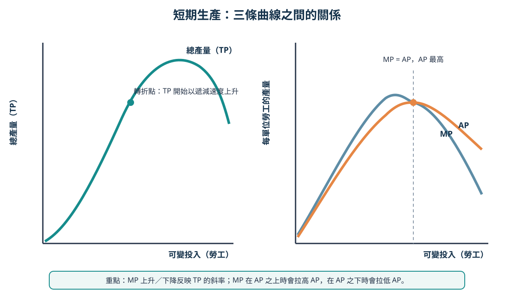

# Topic 5 短期生產

> 中四經濟｜主修 B 第 2 課｜日期：__________

## 今天要學會

- 分辨短期與長期；重點是**有沒有固定投入**，不是日曆上的長短。
- 從表格計算總產量（TP）、平均產量（AP）及邊際產量（MP）。
- 解釋遞減邊際報酬定律，並從 TP／AP／MP 圖表讀出關係。
- 以正確術語解釋增加一單位勞工對產量的影響。

## 1. 短期與長期：看甚麼才對？

在生產理論中，**短期**是至少有一種生產要素固定不變的時期；**長期**是所有生產要素均可以改變的時期。它們不是固定的「一星期」或「一年」。

以一間奶茶店為例，在下月內它或可多聘一名店員，但不能立刻把店舖面積擴大。因此店舖面積是固定投入、店員數目是可變投入，這段時間是短期。若店主有足夠時間搬到更大店舖、添置機器和調整所有投入，則屬長期。

| 時期 | 生產要素可否全部改變？ | 奶茶店例子 |
|---|---|---|
| 短期 | 不可以；至少一項投入固定 | 店舖面積固定，只增加店員 |
| 長期 | 可以；所有投入可改變 | 搬遷、擴充店面、購置更多機器 |

> **記憶句：**短期／長期看「投入的彈性」，不看日曆。

## 2. 三種產量：同一張表，不同問題

假設店舖面積和咖啡機固定，只增加店員。

| 店員人數（勞工） | 總產量 TP（杯／小時） | 平均產量 AP（杯／人／小時） | 邊際產量 MP（每新增一人多做的杯數／小時） |
|---:|---:|---:|---:|
| 0 | 0 | — | — |
| 1 | 10 | ______ | ______ |
| 2 | 26 | ______ | ______ |
| 3 | 39 | ______ | ______ |
| 4 | 48 | ______ | ______ |
| 5 | 53 | ______ | ______ |

### 總產量（TP）

**總產量**是某段時間內所有投入合共生產的總數量。上表中 3 名店員做 39 杯，TP 是 39 杯。

### 平均產量（AP）

**平均產量**是平均每單位可變投入的產量：

```text
AP = 總產量 ÷ 可變投入數量 = TP ÷ 勞工人數
```

例如有 3 名店員，每小時做 39 杯飲品，AP = `39 ÷ 3 = 13` 杯／人／小時。

### 邊際產量（MP）

**邊際產量**是增加一單位可變投入所增加的總產量：

```text
MP = 總產量的改變 ÷ 可變投入數量的改變
```

由 2 名店員變為 3 名店員，TP 由每小時 26 杯升至 39 杯；多聘一名店員令每小時產量增加 `39 − 26 = 13` 杯，因此 MP = 每名新增店員每小時增加 13 杯。

> **AP 問「平均每人做多少」；MP 問「新增加的那一人多做了多少」。**

## 3. TP 與 MP：由固定投入讀懂額外產量

在短期內，店舖面積和咖啡機固定。起初增加店員可令工作分工更細，例如一人沖調、一人收銀，MP 可能上升。可是店員繼續增加後，要共用同一部機器和有限空間，互相等候或阻礙，新增店員帶來的額外產量便會下降。

這就是**遞減邊際報酬定律**：在其他投入固定不變下，連續增加可變投入，當可變投入超過某一點後，每增加一單位可變投入所帶來的額外產量會遞減。



### 先讀 TP，再判斷 MP

| TP 曲線的情況 | MP 的意思 |
|---|---|
| TP 向上而且愈來愈斜 | MP 為正，而且上升 |
| TP 向上但愈來愈平 | MP 為正，但下降 |
| TP 到達最高點 | MP = 0 |
| TP 開始下降 | MP 為負 |

> **讀圖次序：**先看 TP 是上升還是下降，再看斜率變大還是變小。TP 上升不等於 MP 上升；只要 TP 仍上升，MP 仍為正。

## 4. AP 與 MP：平均數如何改變？

MP 也會影響 AP：若新增店員帶來的產量高於原有 AP，平均產量會上升；若低於原有 AP，平均產量會下降。這和新成績高於或低於班級原有平均分的道理一樣。

**逐步示範：MP 為正，AP 仍可下降**

1. 3 名店員每小時做 39 杯，原有 AP = `39 ÷ 3 = 13` 杯／人。
2. 第 4 名店員令 TP 增至每小時 48 杯，故 MP = `48 − 39 = 9` 杯／小時。
3. MP（9）低於原有 AP（13），所以新 AP 降至 `48 ÷ 4 = 12` 杯／人／小時。

因此，**TP 上升、MP 為正，AP 卻下降**並不矛盾；新加入的產量只要低於原有平均，就會拉低平均。

## 必記定義

| 詞語 | HKDSE 答題用語 |
|---|---|
| 短期 | 至少有一種生產要素固定不變的時期。 |
| 長期 | 所有生產要素均可以改變的時期。 |
| 總產量（TP） | 某段時間內的總產出量。 |
| 平均產量（AP） | 平均每單位可變投入的產量。 |
| 邊際產量（MP） | 增加一單位可變投入所增加的總產量。 |
| 遞減邊際報酬定律 | 在其他投入固定不變下，當可變投入超過某一點後，每增加一單位可變投入所帶來的額外產量會遞減。 |

## 課堂練習

### 快問快答

1. 髮型屋在未來一個月可多聘髮型師，但店面和座位數不變。這是短期還是長期？為甚麼？
2. 某工場有 4 名工人，TP 是 60 件。AP 是多少？
3. 工人由 4 名增至 5 名，TP 由 60 件增至 68 件。第 5 名工人的 MP 是多少？
4. TP 繼續上升但曲線愈來愈平，MP 是正、零還是負？它正在上升還是下降？
5. 為甚麼共用一部固定的咖啡機可令 MP 最終下降？

### 選擇題

1. 下列哪項正確描述短期？  
   A. 必定少於一年  
   B. 所有投入都固定  
   C. 至少有一種投入固定不變  
   D. 廠商不能改變任何投入

2. 一間工場由 2 名工人（TP = 24）增至 3 名工人（TP = 33）。第 3 名工人的 MP 是  
   A. 8  
   B. 9  
   C. 11  
   D. 33

3. 某店員人數由 3 人增至 4 人，TP 由 39 杯升至 48 杯。下列哪項正確？  
   A. TP 下降，因為 AP 由 13 杯降至 12 杯  
   B. TP 上升但 AP 下降，因為新增店員的 MP 低於原有 AP  
   C. MP 為負數，因為 AP 下降  
   D. 固定投入增加，所以 AP 下降

4. 下列哪項最能解釋遞減邊際報酬？  
   A. 所有投入同時增加  
   B. 工人數目增加，但店面和機器固定，工人開始互相等候  
   C. 廠商搬到更大工場  
   D. 每增加一名工人，總產量必定下降

5. TP 曲線在某一點達到最高後開始下降，該點以後的 MP 是  
   A. 正數  
   B. 零或正數  
   C. 負數  
   D. 必定等於 AP

### 結構式題目

某甜品店在短期內只有一部雪糕機。下表顯示不同店員數目下，每小時的總產量。

| 店員數目 | 0 | 1 | 2 | 3 | 4 | 5 |
|---:|---:|---:|---:|---:|---:|---:|
| TP（杯） | 0 | 12 | 28 | 42 | 52 | 58 |

1. 計算第 2 至第 5 名店員的 MP。（2 分）
2. 計算 4 名店員時的 AP。（1 分）
3. 解釋為何店員由 3 名增至 5 名時，MP 會下降。（3 分）
4. TP 由 5 名店員後仍上升但上升速度放慢，這反映 MP 有甚麼變化？（2 分）
5. 店主說：「第 5 名店員的 MP 是正數，所以 AP 一定上升。」這個說法正確嗎？用表中數據解釋。（2 分）

---

> **今天最重要的一句話：** TP 看全部產出，AP 看平均每人產出，MP 看多一名工人帶來多少額外產出。
