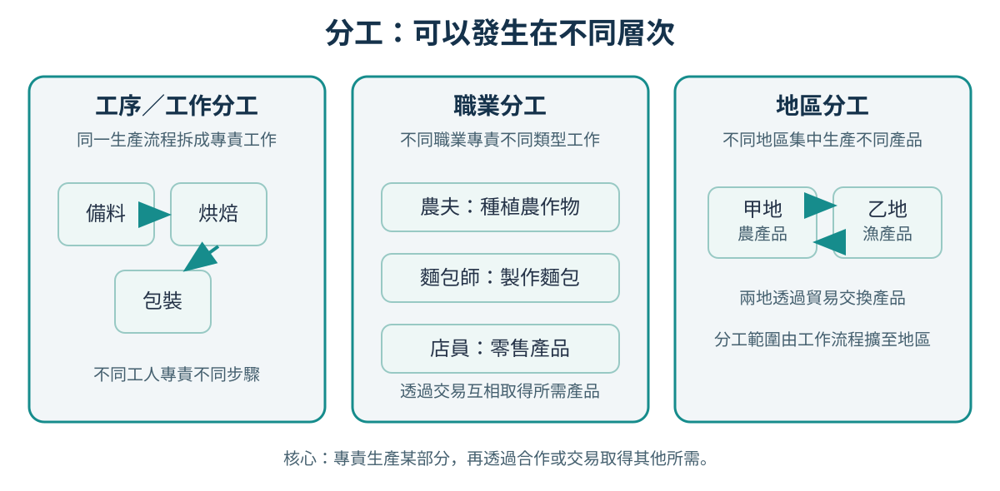
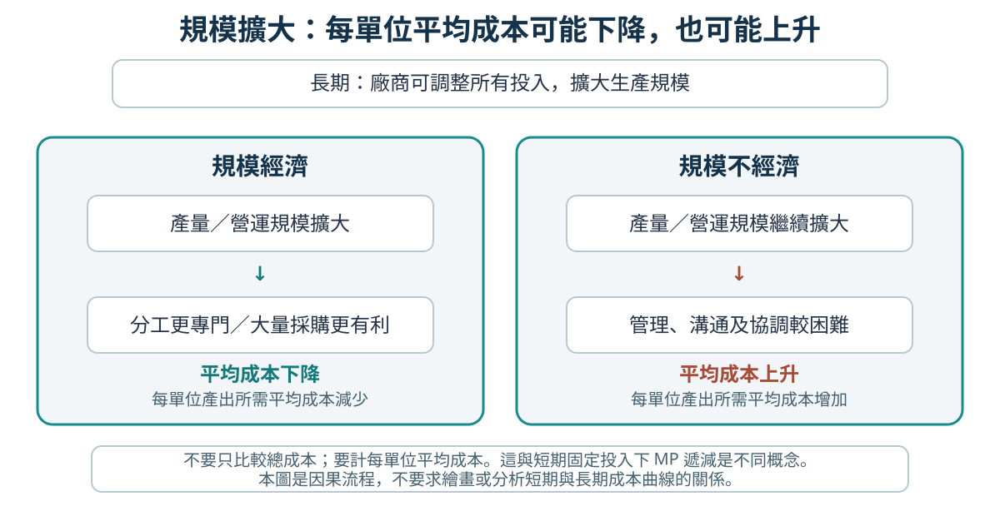
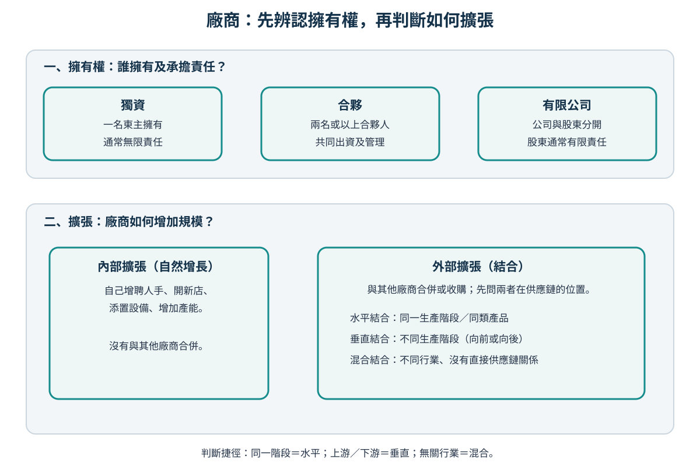

# Topic 6 廠商擁有權、擴張及結合

> 中四經濟｜主修 B 第 4 課｜日期：__________

## 今天要學會

- 解釋規模經濟和規模不經濟，並用平均成本數據辨認兩者。
- 分辨長期規模經濟與短期遞減邊際報酬；兩者的條件和比較對象不同。
- 分辨獨資、合夥和有限公司的基本特徵。
- 從供應鏈圖判斷內部擴張、水平結合、向前／向後垂直結合及混合結合。
- 簡述工序／職業分工與地區分工。

## 1. 前課補充：分工可以發生在不同層次

上課時已用工序分工說明員工各自負責生產流程的一部分。分工也可出現在更廣的層面：不同職業各自專責某類工作，或不同地區集中生產不同產品，再透過交易互相供應。分類用語以校內筆記為準。

## 2. 規模經濟與規模不經濟

**長期平均成本（LRAC）**是長期內每單位產出的平均成本。長期內廠商可調整所有投入；當生產規模擴大時，平均成本可能下降，也可能上升。

- **規模經濟：**廠商擴大長期生產規模時，平均成本下降。較大規模可能讓廠商更容易分工、使用專門設備或大量採購。
- **規模不經濟：**廠商擴大規模時，平均成本上升。組織過大可能令管理、溝通和協調更困難。
- 若平均成本不變，則沒有出現以上兩種成本變化；規模變大不代表必然有規模經濟。

### 逐步示範：不要只比較總成本

麵包店把產量由每月 100 箱增至 200 箱。每月總成本由 $1,000 增至 $1,600。

1. 找所求：比較**每箱平均成本**，不能只看總成本。
2. 選公式：平均成本 = 總成本 ÷ 產量。
3. 代入計算：原來 `$1,000 ÷ 100 = $10/箱`；擴大後 `$1,600 ÷ 200 = $8/箱`。
4. 解讀：產量增加，平均成本由 $10 降至 $8，所以這組數據顯示規模經濟。

### 與遞減邊際報酬分清楚

| 比較 | 遞減邊際報酬 | 規模經濟／不經濟 |
|---|---|---|
| 時期 | 短期，至少一項投入固定 | 長期，所有投入均可改變 |
| 改變甚麼 | 增加可變投入，觀察額外產量（MP） | 擴大生產規模，觀察平均成本 |
| 典型問題 | 「多一名工人增加多少產量？」 | 「規模擴大後，每單位平均成本升還是跌？」 |

本課不要求繪畫 LRAC，也不分析短期與長期成本曲線的一般關係；但仍要懂得規模擴大如何影響平均成本。

## 3. 擁有權：誰擁有廠商，誰承擔風險？

| 類型 | 基本特徵 | 優點例子 | 限制例子 |
|---|---|---|---|
| 獨資 | 一名東主擁有及管理 | 決策快；保留全部利潤 | 資金較有限；通常無限責任 |
| 合夥 | 兩名或以上人士共同經營 | 集合資金、技能和工作分擔 | 意見可能不同；責任安排視乎形式 |
| 有限公司 | 公司與股東在法律上分開 | 較易籌集資金；股東通常有限責任 | 設立及披露要求較多；決策可能較慢 |

- **無限責任：**業務債務可延伸至東主的個人資產。
- **有限責任：**股東通常只承擔其投資額內的損失。

## 4. 擴張與結合：先看供應鏈的位置

**內部擴張**：廠商自行增加資源和產能，例如開新分店、添置設備、聘請員工。  
**外部擴張／結合**：廠商透過合併或收購其他廠商擴張。

### 三步分類法

1. 是廠商自己增加資源嗎？是 → **內部擴張**。
2. 若是收購另一廠商，它們在同一生產階段嗎？是 → **水平結合**。
3. 若否，它們有上游／下游供應鏈關係嗎？有 → **垂直結合**；沒有 → **混合結合**。

| 結合類型 | 如何辨認 | 例子 |
|---|---|---|
| 水平結合 | 同一生產階段、同類產品／服務 | 兩間連鎖麵包店合併 |
| 向後垂直結合 | 收購上游投入品供應商 | 麵包店收購麵粉供應商 |
| 向前垂直結合 | 收購下游配送／零售商 | 製造商收購配送公司或零售店 |
| 混合結合 | 不同行業，沒有直接供應鏈關係 | 茶飲店與手機遊戲公司合併 |

### 逐步示範

情境：本地咖啡連鎖店收購為它運送咖啡豆的物流公司。

1. 咖啡店負責零售；物流公司負責將投入品運到咖啡店。
2. 兩者不在同一生產階段，但位於同一供應鏈的不同階段。
3. 所以是**向前垂直結合**：咖啡店向下游配送服務擴張。

## 圖表與分類答題提示

- **結合題：**不能只因兩間都是公司便寫水平結合；必須比較其供應鏈位置。
- **方向詞：**「向後」是走向投入品供應商；「向前」是走向配送、零售等靠近顧客的階段。

## 課堂練習

### 快問快答

1. 用一句話分別說明規模經濟和規模不經濟。
2. 甲地專門生產蔬菜，乙地專門捕魚，再互相交換產品。這是哪一種分工？
3. 「甲餐廳開設第二間分店」是內部還是外部擴張？為甚麼？
4. 兩間同樣售賣運動鞋的零售商合併，屬哪種結合？
5. 一間廠商改為有限公司後，股東一般承擔甚麼責任？

### 選擇題

1. 一間廠商擴大長期生產規模後，平均成本下降。這是  
   A. 規模經濟  
   B. 規模不經濟  
   C. 遞減邊際報酬  
   D. 邊際成本不變

2. 一間廠商擴大規模後，因管理層級增加、溝通和協調更困難，平均成本上升。這最可能是  
   A. 規模經濟  
   B. 規模不經濟  
   C. 遞減邊際報酬  
   D. 內部擴張

3. 下列何者最能描述有限責任？  
   A. 所有業務債務必須由股東的全部私人資產償還  
   B. 股東通常只承擔其投資額內的損失  
   C. 公司永遠不會虧損  
   D. 公司不能籌集資金

4. 兩間位於同一生產階段、售賣同類貨品的廠商合併，屬於  
   A. 內部擴張  
   B. 水平結合  
   C. 垂直結合  
   D. 混合結合

5. 茶飲店收購與它沒有直接供應鏈關係的電影公司，屬於  
   A. 水平結合  
   B. 向後垂直結合  
   C. 向前垂直結合  
   D. 混合結合

### 結構式題目

「好味食品」原本是一間獨資本地餅店。近年它開設多間分店，並考慮把業務改為有限公司及收購向它供應麵粉的公司。

1. 說出「好味食品」自行開設分店屬於哪種擴張。（1 分）
2. 說出有限公司的一項特徵，並解釋有限責任如何限制股東的損失。（2 分）
3. 「好味食品」收購麵粉供應商屬哪種結合？解釋。（2 分）
4. 說出獨資的一項優點及一項限制。（2 分）
5. 產量由每月 100 箱增至 200 箱，總成本由 $1,000 增至 $1,600。計算兩種產量下的平均成本，並判斷是否出現規模經濟。（3 分）

## 課後練習（約 15–20 分鐘）

1. 麵包店擴大規模前，每月產量 100 箱、總成本 $1,200；擴大後每月產量 150 箱、總成本 $1,650。計算兩個時期的平均成本，並判斷有否規模經濟。（3 分）
2. 判斷以下個案是內部擴張、水平結合、向前垂直結合、向後垂直結合或混合結合，並說明理由：  
   (a) 茶飲店聘請更多店員和購入兩部封口機；  
   (b) 茶飲店收購同區另一間茶飲連鎖店；  
   (c) 茶飲店收購供應茶葉的農場；  
   (d) 茶飲店收購負責送貨的公司；  
   (e) 茶飲店與一家電影製作公司合併。（5 分）
3. 用 2–3 句比較獨資與有限公司在責任和集資能力上的分別。（3 分）
4. 甲地集中種植農作物，乙地集中生產漁產品，兩地交換產品。指出分工類型，並用一句說明分工如何令各地集中生產。（2 分）

---

> **今天最重要的一句話：** 分工可以提高專門化；長期規模擴大可令平均成本下降或上升；廠商的擁有權與結合方式則影響控制、風險和擴張。
