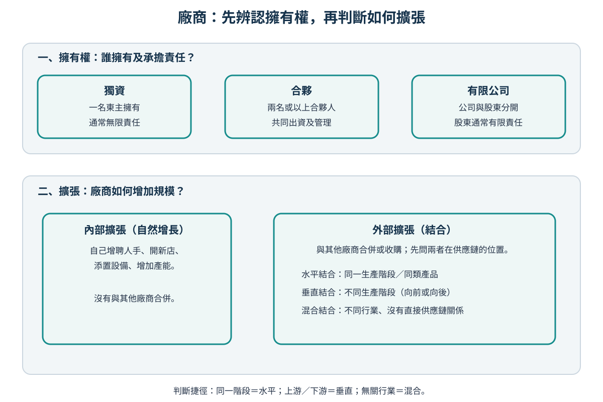

# Topic 6 廠商擁有權、擴張及結合

> 中四經濟｜主修 B 第 4 課｜日期：__________

## 今天要學會

- 簡述 LRAC 和規模經濟的關係；本課不要求畫 LRAC 圖或分析成本曲線關係。
- 分辨獨資、合夥和有限公司的基本特徵。
- 從供應鏈圖判斷內部擴張、水平結合、向前／向後垂直結合及混合結合。

## 1. 本課與前課如何連接？

前課學習短期成本；短期至少有一項投入固定。到了**長期**，廠商有時間改變所有投入，例如搬遷、擴建或添置設備。

### 長期平均成本（LRAC）與規模經濟：只掌握概念

**長期平均成本（LRAC）**是長期內每單位產出的平均成本；它描述廠商在不同產量下的單位成本。若廠商擴大生產規模後，LRAC 下降，稱為**規模經濟**。例如，較大的餅店可把工作分得更細，或使用專門機器，令平均每件產品的成本下降。

這是長期概念，因為廠商須有時間調整所有投入；不要把它與短期內增加勞工時可能出現的遞減邊際報酬混淆。按更新版課程指引的註釋，本課只作概念認識，不要求繪畫 LRAC、判斷曲線形狀，或分析短期與長期成本曲線的一般關係。

## 2. 擁有權：誰擁有廠商，誰承擔風險？

| 類型 | 基本特徵 | 優點例子 | 限制例子 |
|---|---|---|---|
| 獨資 | 一名東主擁有及管理 | 決策快；保留全部利潤 | 資金較有限；通常無限責任 |
| 合夥 | 兩名或以上人士共同經營 | 集合資金、技能和工作分擔 | 意見可能不同；責任安排視乎形式 |
| 有限公司 | 公司與股東在法律上分開 | 較易籌集資金；股東通常有限責任 | 設立及披露要求較多；決策可能較慢 |

- **無限責任：**業務債務可延伸至東主的個人資產。
- **有限責任：**股東通常只承擔其投資額內的損失。

## 3. 擴張與結合：先看供應鏈的位置

**內部擴張**：廠商自行增加資源和產能，例如開新分店、添置設備、聘請員工。  
**外部擴張／結合**：廠商透過合併或收購其他廠商擴張。

### 三步分類法

1. 是廠商自己增加資源嗎？是 → **內部擴張**。
2. 若是收購另一廠商，它們在同一生產階段嗎？是 → **水平結合**。
3. 若否，它們有上游／下游供應鏈關係嗎？有 → **垂直結合**；沒有 → **混合結合**。

| 結合類型 | 如何辨認 | 例子 |
|---|---|---|
| 水平結合 | 同一生產階段、同類產品／服務 | 兩間連鎖麵包店合併 |
| 向後垂直結合 | 收購上游投入品供應商 | 麵包店收購麵粉供應商 |
| 向前垂直結合 | 收購下游配送／零售商 | 製造商收購配送公司或零售店 |
| 混合結合 | 不同行業，沒有直接供應鏈關係 | 茶飲店與手機遊戲公司合併 |

### 逐步示範

情境：本地咖啡連鎖店收購為它運送咖啡豆的物流公司。

1. 咖啡店負責零售；物流公司負責將投入品運到咖啡店。
2. 兩者不在同一生產階段，但位於同一供應鏈的不同階段。
3. 所以是**向前垂直結合**：咖啡店向下游配送服務擴張。

## 課堂練習

### 快問快答

1. 簡述規模經濟與 LRAC 的關係；本課不需畫圖。
2. 「甲餐廳開設第二間分店」是內部還是外部擴張？為甚麼？
3. 兩間同樣售賣運動鞋的零售商合併，屬哪種結合？
4. 運動鞋零售商收購鞋底製造商，屬哪種結合？為甚麼？
5. 一間廠商改為有限公司後，股東一般承擔甚麼責任？

### 選擇題

1. 東主自行開設第二間同類店舖，屬於  
   A. 內部擴張  
   B. 水平結合  
   C. 垂直結合  
   D. 混合結合

2. 一間製衣廠收購向它供應布料的公司，最適合分類為  
   A. 水平結合  
   B. 向後垂直結合  
   C. 向前垂直結合  
   D. 混合結合

3. 下列何者最能描述有限責任？  
   A. 所有業務債務必須由股東的全部私人資產償還  
   B. 股東通常只承擔其投資額內的損失  
   C. 公司永遠不會虧損  
   D. 公司不能籌集資金

4. 兩間位於同一生產階段、售賣同類貨品的廠商合併，屬於  
   A. 內部擴張  
   B. 水平結合  
   C. 垂直結合  
   D. 混合結合

5. 茶飲店收購與它沒有直接供應鏈關係的電影公司，屬於  
   A. 水平結合  
   B. 向後垂直結合  
   C. 向前垂直結合  
   D. 混合結合

### 結構式題目

「好味食品」原本是一間獨資本地餅店。近年它開設多間分店，並考慮把業務改為有限公司及收購向它供應麵粉的公司。

1. 說出「好味食品」自行開設分店屬於哪種擴張。（1 分）
2. 說出有限公司的一項特徵，並解釋有限責任如何限制股東的損失。（2 分）
3. 「好味食品」收購麵粉供應商屬哪種結合？解釋。（2 分）
4. 說出獨資的一項優點及一項限制。（2 分）

---

> **今天最重要的一句話：** 廠商擴張要看是自行增加資源，還是與供應鏈中的其他廠商結合；擁有權形式則影響控制、資金和責任。
