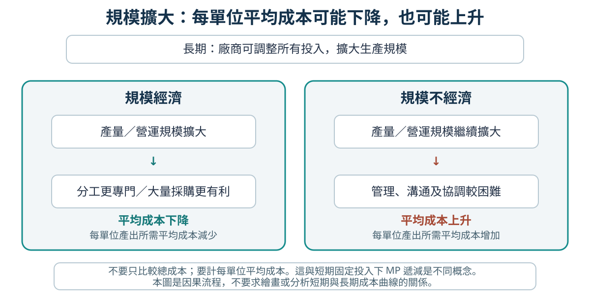

# Topic 6 規模經濟、廠商擴張與結合

> 中四經濟｜主修 B｜日期：__________

## 今天要學會

- 以平均成本解釋內部／外部規模經濟和規模負經濟，並說出可能原因。
- 分清長期規模效果與短期遞減邊際報酬。
- 分辨廠商內部擴張，以及橫向、縱向、側向和集團結合。
- 在具體情境中解釋廠商選擇擴張或結合的可能動機。

## 1. 規模擴大如何影響平均成本？

**平均成本（AC）= 總成本 ÷ 產量。**長期內廠商可以改變所有生產要素。比較規模擴大前後時，要比較每單位平均成本，不可只看總成本；總成本即使上升，平均成本仍可能下降。



| 名稱 | 意思 | 例子 |
|---|---|---|
| 內部規模經濟 | 廠商本身擴大規模，令其 AC 下降 | 訂單增加後可分工、使用較大型設備或大量採購 |
| 外部規模經濟 | 整個行業擴大，令行業內廠商的 AC 下降 | 行業聚集後出現更多專門供應商、熟練工人或共用基建 |
| 內部規模負經濟 | 廠商本身過度擴大，令其 AC 上升 | 管理層級增多，溝通、監督和協調更困難 |
| 外部規模負經濟 | 整個行業過度集中，令行業內廠商的 AC 上升 | 地區擠塞、租金或工資上升，令多間廠商成本增加 |

「內部／外部」指出成本變化來自個別廠商還是整個行業；不用把各種原因背成更多細分類。

### 逐步示範：用 AC 判斷

麵包店產量由每月 100 箱增至 200 箱，總成本由 $1,000 增至 $1,600。

1. 找所求：比較每箱平均成本。
2. 選公式：`AC = 總成本 ÷ 產量`。
3. 計算：擴大前 `$1,000 ÷ 100 = $10/箱`；擴大後 `$1,600 ÷ 200 = $8/箱`。
4. 解讀：AC 下降，出現規模經濟；若原因是麵包店自己增加分工，屬內部規模經濟。

### 不要與遞減邊際報酬混淆

| 比較 | 遞減邊際報酬 | 規模經濟／規模負經濟 |
|---|---|---|
| 時期 | 短期，至少一項投入固定 | 長期，所有投入均可改變 |
| 比較對象 | 多投入一單位可變要素帶來的額外產量 MP | 規模擴大後的平均成本 AC |
| 典型問題 | 「多一名工人增加多少產量？」 | 「擴大後每箱平均成本上升還是下降？」 |

本課只用平均成本及數據說明，不畫規模成本曲線，也不延伸至短期與長期成本曲線的關係。

## 2. 廠商為甚麼擴張或結合？

廠商可自行增加店舖、員工或設備，這是**內部擴張**。廠商也可與其他廠商結合。分類時先比較雙方的生產階段和產品，再看有沒有直接供應鏈關係。

```text
原材料供應商 → 製造商 → 批發／配送 → 零售商 → 顧客
```

| 結合類型 | 判斷方法 | 例子 |
|---|---|---|
| 縱向結合 | 同一供應鏈的不同生產階段 | 麵包店與麵粉供應商結合 |
| 橫向結合 | 同一行業、同一生產階段、相同或相似產品 | 兩家麵包店結合 |
| 側向結合 | 同一生產階段，但產品不同而相關 | 麵包製造商與蛋糕製造商結合 |
| 集團結合 | 不同行業、沒有直接供應鏈關係 | 麵包製造商與旅遊公司結合 |

> **記法：**縱向看供應鏈上下游；橫向看相同產品；側向看同階段的相關產品；集團看不相關行業。

縱向結合也可按方向描述：走向上游投入品供應商是**向後結合**；走向下游批發、配送或零售商是**向前結合**。

### 結合可能有甚麼動機？

- **擴大市場佔有率或減少競爭：**橫向結合後，廠商可接觸更多顧客。
- **穩定投入品或銷售渠道：**縱向結合可減少對上游供應商或下游分銷商的依賴。
- **擴闊產品種類：**側向結合讓廠商向相近市場提供更多產品。
- **分散業務風險：**集團結合把業務擴展至不同市場。
- **擴大規模、降低平均成本：**更大規模可能帶來內部規模經濟；但若管理成本上升，也可能出現規模負經濟。

動機是可能的好處，不代表結合必然成功或成本必然下降。課程不要求掌握結合的法律／商業方法。

### 逐步分類例子

一間本地麵包製造商與一間蛋糕製造商結合：

1. 兩者都製造食品，處於相同生產階段。
2. 產品不同，但彼此相關。
3. 因此是**側向結合**；可能的動機是擴闊產品種類和顧客群。

## 課堂練習

### 快問快答

1. 廠商擴大生產後，總成本上升；如何判斷是否出現規模經濟？
2. 一個行業聚集後，專門供應商增加，令行業內廠商的 AC 下降。這是內部還是外部規模經濟？
3. 說出一個可能導致內部規模負經濟的原因。
4. 兩間不同品牌的麵包店結合，屬哪種結合？廠商可能有甚麼動機？
5. 麵包店和蛋糕製造商結合，屬橫向、側向還是集團結合？

### 選擇題

1. 某廠商規模擴大前每件 AC 為 $12，擴大後為 $10。<br>
   A. 規模經濟<br>
   B. 規模負經濟<br>
   C. 遞減邊際報酬<br>
   D. 外部擴張

2. 行業整體擴大，令多家廠商較容易聘用受過專門訓練的員工，平均成本下降。這最可能是<br>
   A. 內部規模經濟<br>
   B. 外部規模經濟<br>
   C. 內部規模負經濟<br>
   D. 遞減邊際報酬

3. 一家零售商結合上游供應商，最可能屬於<br>
   A. 橫向結合<br>
   B. 縱向結合<br>
   C. 側向結合<br>
   D. 集團結合

4. 兩家同一階段的廠商生產不同但相關的食品，最適合稱為<br>
   A. 縱向結合<br>
   B. 橫向結合<br>
   C. 側向結合<br>
   D. 集團結合

5. 下列哪項是集團結合的可能動機？<br>
   A. 確保取得一種指定原材料<br>
   B. 擴大同一產品的市場佔有率<br>
   C. 分散業務至不相關市場<br>
   D. 取得同一供應鏈的下游零售渠道

### 結構式題目

「安樂食品」擴大產量後，平均成本由每箱 $15 降至 $12。它其後與一間同階段、製造不同種類糕點的廠商結合。

1. 說明平均成本數據顯示甚麼規模效果。（1 分）
2. 假設成本下降是由「安樂食品」自身採用專門設備所致，指出是內部還是外部規模經濟，並解釋。（2 分）
3. 分類兩家廠商的結合，並指出一個可能動機。（2 分）
4. 若產量再增加後平均成本反而上升，指出一個可能的內部原因。（1 分）

## 課後練習（約 15 分鐘）

1. 一個食品製造業聚集區吸引專門包裝公司和熟練工人進駐。說明這可能如何影響區內廠商的平均成本，並分類為內部或外部規模經濟。（2 分）
2. 分類並各寫一個可能動機：（a）兩家同類超市結合；（b）零售商與飲品生產商結合；（c）麵包廠與蛋糕廠結合；（d）麵包廠與酒店集團結合。（8 分）

> **今天最重要的一句話：**規模效果看 AC；結合類型看生產階段、產品關係和供應鏈位置。
